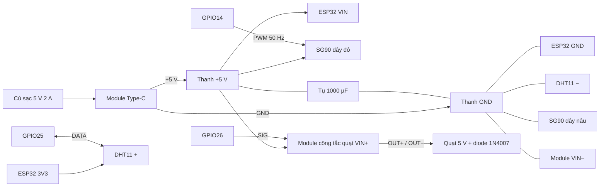

# Phần cứng node chuồng trại

Một node gồm ESP32 38 chân, cảm biến DHT11, quạt DC 5 V (đóng cắt qua GPIO26), servo SG90 cho ăn.
**Tất cả dùng chung một nguồn 5 V** (củ sạc điện thoại 5 V 2 A qua module Type-C) và chung GND.
Không dùng điện lưới 220 V.

Chân trong tài liệu này **khớp với code hiện tại** (`firmware/config.example.json`), không phải với
bản nháp báo cáo. Xem mục [Khác với báo cáo](#khác-với-báo-cáo).

- [bom.csv](bom.csv): danh sách linh kiện kèm giá tham khảo

## Sơ đồ chân ESP32

| Linh kiện | Chân linh kiện | Chân ESP32 | Khai báo trong `config.json` | Ghi chú |
| --- | --- | --- | --- | --- |
| DHT11 (module 3 chân) | S / DATA | **GPIO25** | `sensors[].pin: 25`, `driver: "dht11"` | Module có sẵn trở kéo lên; nuôi bằng 3V3 |
| Servo SG90 | dây cam (tín hiệu) | **GPIO14** | `actuators[].pin: 14`, `driver: "servo"` | PWM 50 Hz, 500–2400 µs |
| Công tắc quạt | SIG / IN | **GPIO26** | `actuators[].pin: 26`, `driver: "relay"` | Module MOSFET AOD4184 (khuyên dùng) hoặc module relay 5 V 1 kênh |
| Nguồn ESP32 | VIN (có board ghi 5V) | 5 V chung | — | Không cấp 5 V vào chân 3V3 |
| GND | GND | GND chung | — | Mọi GND nối chung một điểm |

Driver `relay` trong firmware chỉ là một ngõ ra bật/tắt, nên dùng được cho cả module MOSFET lẫn
module relay. Module relay loại kích mức thấp (nhiều module bán sẵn là loại này) thì đặt
`"active_low": true`. Module MOSFET AOD4184 kích mức cao, để `false`.

Không dùng: GPIO0, 2, 5, 12, 15 (chân strapping), GPIO6–11 (flash), GPIO34–39 (chỉ đọc vào, không ra
được). LED trên GPIO2 trong báo cáo hiện **chưa có trong code**.

## Đấu dây

Làm theo thứ tự, **rút sạc** trong lúc nối. Breadboard có hai thanh dài: thanh + (vạch đỏ) là 5 V,
thanh − (vạch xanh) là GND.

| # | Từ | Đến | Ghi chú |
| --- | --- | --- | --- |
| 1 | Module Type-C, VBUS (5V) | Thanh + | Cắm sạc vào module này sau cùng |
| 2 | Module Type-C, GND | Thanh − | |
| 3 | ESP32, VIN | Thanh + | |
| 4 | ESP32, GND | Thanh − | |
| 5 | DHT11, + (VCC) | ESP32, 3V3 | |
| 6 | DHT11, S (DATA) | ESP32, GPIO25 | |
| 7 | DHT11, − | Thanh − | |
| 8 | Servo, dây cam | ESP32, GPIO14 | |
| 9 | Servo, dây đỏ | Thanh + | Không lấy từ 3V3 |
| 10 | Servo, dây nâu | Thanh − | |
| 11 | Tụ 1000 µF 16 V | Chân dài vào +, chân có vạch vào − | Cắm sát chỗ cắm servo, đúng cực |
| 12 | Module công tắc quạt, VIN+/VCC và VIN−/GND | Thanh + và thanh − | |
| 13 | Module công tắc quạt, SIG/IN | ESP32, GPIO26 | |
| 14 | Quạt, dây đỏ / đen | Ngõ ra của module (OUT+/OUT−, hoặc COM/NO với relay) | Xem ghi chú dưới |
| 15 | Diode 1N4007 | Song song quạt, vạch trắng về phía dây đỏ (+) | Chống xung ngược khi quạt tắt |

Ghi chú mục 14:

- **MOSFET AOD4184**: dây đỏ quạt vào OUT+, dây đen vào OUT−. Module tự lấy 5 V từ VIN+.
- **Relay**: thanh + → COM, NO → dây đỏ quạt, dây đen quạt → thanh −. Quạt chỉ chạy khi relay đóng.

## Nguồn chung: tính dòng

Mọi tải lấy từ một củ sạc 5 V 2 A, nên tổng dòng đỉnh phải dưới khoảng 1,6 A (chừa 20% vì củ sạc rẻ
thường không đủ dòng như ghi trên nhãn).

| Tải | Dòng thường | Dòng đỉnh |
| --- | --- | --- |
| ESP32 khi phát Wi-Fi | ~80 mA | ~250 mA |
| DHT11 | ~1 mA | ~2,5 mA |
| Servo SG90 | ~200 mA khi quay | ~650–700 mA lúc khởi động hoặc kẹt |
| Quạt 5 V nhỏ (4010–6025) | 100–250 mA | ~300 mA lúc khởi động |
| Cuộn relay 5 V (nếu dùng relay) | ~70 mA | ~70 mA |
| **Tổng** | **~0,4–0,6 A** | **~1,3 A** |

Kết luận: 5 V 2 A đủ, nhưng không dư nhiều. Để tránh ESP32 tự khởi động lại (brownout):

- Tụ 1000 µF sát servo là bắt buộc, không bỏ.
- Dùng cáp ngắn, dây nguồn to; củ sạc phải đúng loại 2 A trở lên.
- Không đổi sang MG996R với nguồn này (dòng kẹt tới ~2,5 A); muốn dùng thì lên 5 V 3 A.
- Nếu thấy ESP32 reset đúng lúc quạt và servo cùng chạy, kiểm tra lại cách cấp nguồn trước khi nghĩ
  là lỗi code.

**Khi nạp code qua USB laptop**: cổng USB chỉ cấp ~500 mA. Rút dây 5 V của servo (đúng như
`firmware/README.md`), hoặc giữ củ sạc cắm và chỉ dùng USB để truyền dữ liệu (GND chung).

## An toàn

- Không nối 5 V vào chân 3V3. Không nối thẳng thanh + sang thanh −.
- Tụ và diode phải đúng chiều: tụ ngược cực có thể phồng, nổ; diode ngược là chập nguồn quạt.
- Không cắm động cơ trực tiếp vào chân GPIO; GPIO chỉ ra 3,3 V vài chục mA.
- Chỉ dùng tải 5 V. Không đấu relay vào điện 220 V hay quạt AC trong demo.
- `config.example.json` đang để servo **tự quay 0→180° khi khởi động** (`sequence.autostart: true`).
  Với bộ cho ăn thật, cửa xả sẽ mở liên tục. Đặt `"autostart": false` trong `config.json` trước khi
  lắp vào mô hình.
- GPIO14 có thể phát xung ngắn lúc ESP32 khởi động, servo có thể giật nhẹ một lần. Cửa xả nên ở vị trí
  đóng khi lắp.

## Thử từng phần

1. Đo 5 V trên breadboard đúng cực (4,9–5,2 V) trước khi cắm ESP32.
2. DHT11: chạy firmware, xem telemetry có `temperature`, `humidity`; nắm tay vào cảm biến thì tăng.
3. Quạt: gửi lệnh `relay_set` `{"on": true}` rồi `{"on": false}`; quạt quay/dừng, ESP32 không reset.
4. Servo: gửi `servo_set` `{"angle": 0}`, `{"angle": 90}`; quay đủ góc, ESP32 không reset.
5. Cho quạt và servo chạy cùng lúc vài lần để chắc nguồn chung chịu được.

## Khác với báo cáo

Bản nháp báo cáo và tài liệu BOM cũ dùng chân khác. Code là bản đang chạy, nên báo cáo cần sửa theo
bảng này (hoặc nhóm đổi `config.json` về chân cũ):

| Mục | Code (tài liệu này) | Báo cáo / BOM cũ |
| --- | --- | --- |
| DHT11 DATA | GPIO25 | GPIO4 |
| Servo tín hiệu | GPIO14 | GPIO13 |
| Công tắc quạt | GPIO26, driver `relay` | GPIO26, module MOSFET AOD4184 |
| LED trạng thái | chưa có | GPIO2 |
| Nguồn | một củ sạc 5 V 2 A chung | giống |
